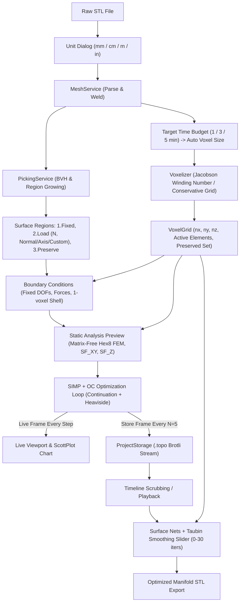

# TopoOpt Architecture Specification

## 1. Project Layout & Dependencies
```text
StlOptimizer/
├── src/
│   ├── TopoOpt.Core/           # net10.0 class library: Pure numerics, voxelization, FEM, SIMP, zero UI deps
│   │   ├── Geometry/           # Triangle meshes, BVH, half-edge, picking, welding, unit scaling
│   │   ├── Voxelization/       # Voxel grids, ray parity, winding numbers, boundary mapping, time-budget estimator
│   │   ├── Fem/                # Hex8 element, matrix-free operator, 8-colour PCG solver
│   │   ├── Optimization/       # SIMP, density filters, OC bisection, Heaviside projection, continuation
│   │   ├── PostProcessing/     # Centroid/nodal von Mises, Surface Nets, Taubin smoothing
│   │   ├── Materials/          # FDM material profiles (PLA, PLA+, PETG) & anisotropic safety factors
│   │   └── Persistence/        # .topo project serialization, Brotli compression, binary STL export
│   ├── TopoOpt.App/            # net10.0 Avalonia desktop application (MVVM, dark UI, 3D viewport)
│   │   ├── Controls/           # OpenGl3DViewport (OpenGlControlBase + Silk.NET)
│   │   ├── Rendering/          # Shaders (GLSL ES 3.00), mesh buffers, camera, picking renderer
│   │   ├── ViewModels/         # MainViewModel, TimelineViewModel, MaterialViewModel, MetricsViewModel
│   │   ├── Views/              # MainWindow, ViewportView, InspectorView, TimelineView, UnitDialog
│   │   └── Resources/          # Strings.resx (English v1, localization ready)
│   └── TopoOpt.Cli/            # net10.0 headless CLI dev tool: benchmark runner, batch jobs, validation
├── tests/
│   └── TopoOpt.Core.Tests/     # xUnit test suite: analytical benchmarks, beam deflections, SIMP tests
├── docs/                       # Architectural decisions, research, roadmap, step logs
├── AGENTS.md                   # Strict engineering rules for AI coding assistants
├── LICENSE                     # GNU General Public License v3.0 (GPLv3)
└── TopoOpt.sln
```

### Approved NuGet Dependencies (GPLv3 Compatible)
- `Avalonia` (12.1.4, MIT)
- `Avalonia.Desktop` (12.1.4, MIT)
- `Avalonia.Themes.Fluent` (12.1.4, MIT)
- `CommunityToolkit.Mvvm` (8.4.0, MIT)
- `Silk.NET.OpenGL` (2.22.0, MIT)
- `ScottPlot.Avalonia` (5.x, MIT)
- `Material.Icons.Avalonia` (MIT)
- `xunit` (2.9.x, Apache-2.0)
- `xunit.runner.visualstudio` (2.8.x, MIT)

---

## 2. Public Interfaces (Signatures Only)

```csharp
namespace TopoOpt.Core.Geometry;

public enum LengthUnit { Millimeter, Centimeter, Meter, Inch }

public readonly record struct Vector3F(float X, float Y, float Z);
public readonly record struct Ray(Vector3F Origin, Vector3F Direction);
public readonly record struct HitResult(bool IsHit, float Distance, int TriangleIndex, Vector3F Point);

public interface ITriangleMesh
{
    ReadOnlySpan<Vector3F> Vertices { get; }
    ReadOnlySpan<int> Indices { get; }
    ReadOnlySpan<Vector3F> FaceNormals { get; }
    (Vector3F Min, Vector3F Max) BoundingBox { get; }
}

public interface IMeshService
{
    ITriangleMesh LoadStl(Stream stream, LengthUnit unit = LengthUnit.Millimeter, float weldTolerance = 1e-5f);
    void SaveStl(Stream stream, ITriangleMesh mesh, bool binary = true);
    ITriangleMesh Repair(ITriangleMesh mesh);
}

public interface IPickingService
{
    void BuildBvh(ITriangleMesh mesh);
    HitResult RayCast(Ray ray);
    IReadOnlyList<int> GrowRegionByAngle(ITriangleMesh mesh, int seedTriangle, float maxDihedralAngleDeg);
    IReadOnlyList<int> SelectCylindricalHole(ITriangleMesh mesh, int seedTriangle, float radiusTolerance);
}
```

```csharp
namespace TopoOpt.Core.Voxelization;

public readonly record struct VoxelCoord(int X, int Y, int Z);

public sealed class VoxelGrid
{
    public int Nx { get; init; }
    public int Ny { get; init; }
    public int Nz { get; init; }
    public float VoxelSize { get; init; }
    public Vector3F Origin { get; init; }
    public int[] ActiveElements { get; init; } // Flat indices: ix + nx * (iy + ny * iz)
    public HashSet<int> PreservedElements { get; init; } = new(); // Frozen rho = 1.0
}

public interface IVoxelizer
{
    float EstimateVoxelSizeForTimeBudget(ITriangleMesh mesh, TimeSpan targetDuration);
    VoxelGrid Voxelize(ITriangleMesh mesh, float voxelSize, CancellationToken ct = default);
    int[] MapSurfaceTrianglesToNodes(VoxelGrid grid, ReadOnlySpan<int> triangleIndices, ITriangleMesh mesh, float dilationFactor = 1.0f);
    int[] MapSurfaceTrianglesToPreservedElements(VoxelGrid grid, ReadOnlySpan<int> triangleIndices, ITriangleMesh mesh);
}
```

```csharp
namespace TopoOpt.Core.Fem;

public enum LoadDirectionType { NormalInward, NormalOutward, GlobalAxis, CustomVector }

public readonly record struct LoadDefinition(
    int[] NodeIndices,
    float TotalForceNewtons,
    LoadDirectionType DirectionType,
    Vector3F CustomDirection
);

public readonly record struct BoundaryCondition(
    int[] FixedDofs,
    (int Dof, float Magnitude)[] AppliedLoads,
    int[]? ProtectiveShellElementIndices = null
);

public sealed class FemSolution
{
    public float[] Displacements { get; init; }
    public float[] ElementVonMises { get; init; }
    public float[] NodalVonMises { get; init; }
    public float Compliance { get; init; }
    public float MaxDisplacement { get; init; }
    public float MaxStress { get; init; }
    public float SafetyFactorXy { get; init; }
    public float SafetyFactorZ { get; init; }
    public float GlobalSafetyFactor => MathF.Min(SafetyFactorXy, SafetyFactorZ);
}

public interface IFemSolver
{
    FemSolution Solve(
        VoxelGrid grid,
        ReadOnlySpan<float> elementDensities,
        BoundaryCondition bc,
        float youngModulus,
        float poissonRatio,
        float tensileStrengthXy,
        float tensileStrengthZ,
        float[]? warmStartDisplacements = null,
        CancellationToken ct = default);
}
```

```csharp
namespace TopoOpt.Core.Optimization;

public enum OptimizationMode { HighQualityCrisp, FastDraft }

public sealed record OptimizationParameters(
    float TargetVolumeFraction = 0.30f,
    float FilterRadius = 2.0f,
    int MaxIterations = 200,
    float MoveLimit = 0.2f,
    float Penalty = 3.0f,
    OptimizationMode Mode = OptimizationMode.HighQualityCrisp,
    bool ProtectBoundaryHinges = true
);

public sealed record OptimizationProgress(
    int Iteration,
    float CurrentCompliance,
    float CurrentVolumeFraction,
    float ChangeMax,
    float NonDiscreteness,
    ReadOnlyMemory<float> Densities
);

public interface ITopologyOptimizer
{
    Task<IReadOnlyList<ReadOnlyMemory<float>>> OptimizeAsync(
        VoxelGrid grid,
        BoundaryCondition bc,
        OptimizationParameters parameters,
        int historyFrequency = 5,
        IProgress<OptimizationProgress>? progress = null,
        CancellationToken ct = default);
}
```

```csharp
namespace TopoOpt.Core.PostProcessing;

public interface IIsoSurfaceExtractor
{
    ITriangleMesh ExtractIsosurface(VoxelGrid grid, ReadOnlySpan<float> densities, float isoValue = 0.5f);
    ITriangleMesh ApplyTaubinSmoothing(ITriangleMesh mesh, int iterations = 10, float lambda = 0.5f, float mu = -0.53f);
}
```

```csharp
namespace TopoOpt.Core.Persistence;

public sealed record ProjectMetadata(
    string Name,
    DateTime CreatedUtc,
    string MaterialName,
    LengthUnit ImportUnit,
    float VoxelSize,
    int HistoryFrequency,
    OptimizationParameters Parameters
);

public interface IProjectStorage
{
    Task SaveAsync(string path, ProjectMetadata metadata, ITriangleMesh inputMesh, IReadOnlyList<ReadOnlyMemory<float>> history, CancellationToken ct = default);
    Task<(ProjectMetadata Metadata, ITriangleMesh Mesh, IReadOnlyList<float[]> History)> LoadAsync(string path, CancellationToken ct = default);
}
```

---

## 3. Data Flow


---

## 4. Threading Model
- **UI Thread (Avalonia Dispatcher)**:
  - Dispatches UI events, timeline scrubbing, camera transformations, and control updates.
  - Never executes FEM computations, voxelization, or file compression.
- **Worker / Background Thread (`Task.Run` / `ThreadPool`)**:
  - Executes CPU-bound tasks: mesh welding, voxel ray-casting, PCG matrix-free iterations, sensitivity filtering, and Surface Nets extraction.
  - Communicates with UI exclusively via `IProgress<OptimizationProgress>` updates throttled to $\le 30$ FPS.
- **Render Thread / OpenGL Context**:
  - `OpenGlControlBase` executes rendering on Avalonia's render loop (`OnOpenGlRender`).
  - Read-only consumption of thread-safe immutable snapshots or pinned vertex buffers prepared by background tasks.

---

## 5. File Formats
### `.topo` Project Container (ZipArchive)
- `manifest.json`: Project metadata, material selection, voxel dimensions, boundary condition node sets, optimization hyper-parameters, history frequency $N$.
- `model.stl`: Original imported and welded boundary STL geometry.
- `history.bin`: Binary stream containing:
  - Header: `uint32 active_element_count`, `uint32 iteration_count`, `uint32 saved_frames_count`.
  - Body: Quantized density frames (`uint8` per active element, $\rho \in [0, 255]$) saved every $N=5$ iterations (plus iter 0 and final), compressed with `BrotliStream` (Fastest compression).

---

## 6. Performance Budgets (Reference: 20-thread CPU, 64 GB RAM)
| Active Elements | DOFs ($\approx 3 \times N$) | Target PCG Solve (Warm) | Total Iteration Time | 200-Iter Total Time | Memory Usage |
| :--- | :--- | :--- | :--- | :--- | :--- |
| **100,000** | $\approx 330,000$ | $\le 50\text{ ms}$ | $\le 100\text{ ms}$ | $\le 20\text{ s}$ | $\le 250\text{ MB}$ |
| **500,000** | $\approx 1,650,000$ | $\le 250\text{ ms}$ | $\le 400\text{ ms}$ | $\le 80\text{ s}$ | $\le 1.1\text{ GB}$ |
| **1,000,000** | $\approx 3,300,000$ | $\le 600\text{ ms}$ | $\le 1,000\text{ ms}$ | $\le 3.5\text{ min}$ | $\le 2.4\text{ GB}$ |
| **Viewport** | $\ge 1,000,000$ tris | $\le 16.6\text{ ms}$ ($\ge 60\text{ FPS}$) | Dynamic VBO swap | Smooth rotation | $\le 500\text{ MB VRAM}$ |
